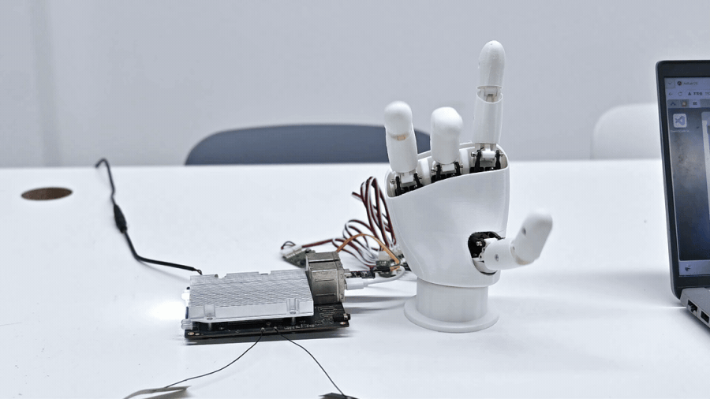

# AmazingHand_Rhinopi_A1

[](LICENSE)
[](DEPLOY_qcm6490_aidlux.md)
[](tools/requirements.txt)

**Languages**: English | [简体中文](README.md)

A **field-verified port** of the [Pollen Robotics AmazingHand](https://github.com/pollen-robotics/AmazingHand)
dexterous hand to a **Qualcomm QCM6490** board running AidLux / Ubuntu 24.04.

> 8-DOF open-source dexterous hand · 8 × Feetech SCS0009 serial-bus servos · Python + `rustypot`

The repository is split into two parts:

| Directory | Contents |
|---|---|
| `upstream/AmazingHand-main/` | Full snapshot of the upstream Pollen Robotics project (CAD / STL / firmware / official examples / assembly docs / MuJoCo simulation) |
| `tools/` | The runnable adaptation layer for the QCM6490 (AidLux) board, validated on real hardware |

---

## Gesture showcase



> The animation above was **recorded on the real QCM6490 (AidLux) board**:
> `python tools/hand_demo.py --loops 0` plays the full built-in sequence over the
> 1 Mbps servo bus, with all 8 servos closed-loop tracking.

`tools/hand_demo.py` ships 12 gestures, all computed on the fly as
“middle position + offset”:

| Gesture | Motion | Gesture | Motion |
|---|---|---|---|
| `open_hand` | All fingers fully extended | `nonono` | Index finger waving side to side |
| `close_hand` | Fast fist clench | `perfect` | Thumb meets index (OK / thumbs-up) |
| `open_hand_progressive` | Fingers extend one by one | `victory` | V sign |
| `spread_hand` | Fingers fanned out sideways | `scissors` | V sign opening and closing |
| `clench_hand` | Firm grasp | `pinched` | Thumb–fingertip pinch |
| `index_pointing` | Only the index extended | `rock_sign` | Rock sign (index + pinky) |

Reproduce it with:

```bash
python tools/hand_demo.py --side right   # right hand; use --side left for the left hand
python tools/hand_demo.py --loops 0       # loop forever
```

> Gesture direction depends on a correct middle position and the right `--side`;
> on an uncalibrated hand the fingers will skew. See [Calibration](#calibration).

---

## What this repository solves

Upstream AmazingHand ships complete CAD, an Arduino example and a Python demo — but that demo:

- hard-codes the serial port as `COM11`, so it breaks on any other machine
- never checks whether the servos are actually online; a miswired bus raises a bare `Timeout error` with no hint about the cause
- requires editing `Side = 1` in the source to switch hands
- offers no way to debug without hardware

This repository is its adaptation for **Qualcomm QCM6490 / AidLux**, focused on portability and debuggability:

| Change | Description |
|---|---|
| Serial auto-detection | No hard-coded port. On Linux it scans `/dev/ttyUSB*`, `/dev/ttyACM*`, `/dev/ttyCH343USB*`, etc.; on Windows it enumerates real COM ports via `pyserial` |
| Servo presence scan | Probes IDs 1–8 at startup and reports each one; missing IDs are listed explicitly |
| Bus diagnostics | `scan_bus.py` prints position / voltage / temperature / torque-enable for every servo in one table |
| Closed-loop check | `verify_closed_loop.py` commands a pose, reads back actual positions and reports per-ID error; measured < 1.4° on real hardware |
| Left / right hand | `--side right \| left`, no source edits |
| Dry-run mode | `--dry-run` prints every target frame without hardware, for logic and gesture debugging |
| Calibration injection | `--middle-pos` takes the 8 calibrated middle positions directly |
| Windows support | The same code also runs on Windows with a CH340 adapter |

---

## Hardware

| Item | Detail |
|---|---|
| Host | Qualcomm QCM6490 (AidLux / Ubuntu 24.04.3 LTS) |
| Hand | AmazingHand, 8 × Feetech **SCS0009** serial-bus servos |
| Adapter | Feetech TTL bus adapter (USB-Serial, CH340 / CP2102, etc.) |
| Bus settings | **1 000 000 bps**, servo IDs 1–8 |

Servo ID ↔ finger mapping (two servos per finger; the `MiddlePos` index is `id-1`):

| Finger | Servo IDs | MiddlePos index |
|---|---|---|
| index | 1, 2 | 0, 1 |
| middle | 3, 4 | 2, 3 |
| ring | 5, 6 | 4, 5 |
| thumb | 7, 8 | 6, 7 |

> Mechanical parts, printed parts and assembly drawings are included under
> `upstream/AmazingHand-main/cad/`. Original source:
> <https://github.com/pollen-robotics/AmazingHand>

---

## Quick start

> The complete **on-device deployment procedure** (measured environment data, wiring,
> systemd autostart, rustypot API quirks) is in **[DEPLOY_qcm6490_aidlux.md](DEPLOY_qcm6490_aidlux.md)**
> — currently written in Chinese. The shortest path is below.

### 1. Clone and install dependencies

```bash
git clone https://github.com/XIZAINB/AmazingHand_Rhinopi_A1.git
cd AmazingHand_Rhinopi_A1

python3 -m venv .venv
source .venv/bin/activate
pip install -r tools/requirements.txt
```

### 2. Serial port permissions

On Ubuntu, accessing `/dev/ttyUSB*` requires membership in the `dialout` group,
otherwise you get `Permission denied`:

```bash
sudo usermod -aG dialout $USER
```

Log out and back in for the change to take effect. Alternatively run with `sudo` as a temporary workaround.

### 3. Confirm the adapter is detected

```bash
ls -l /dev/ttyUSB* /dev/ttyACM* 2>/dev/null
dmesg | tail -20          # plug/unplug the adapter and watch the kernel enumerate it
```

### 4. Scan the servos

```bash
python tools/probe_servos.py          # probe every serial port
python tools/probe_servos.py /dev/ttyUSB0
```

Expected output:

```
== /dev/ttyUSB0 ==
  [发现] 舵机 ID: [1, 2, 3, 4, 5, 6, 7, 8]
    ID  1: 位置=+1.2579 rad  电压=51.0 V  温度=21 °C
    ...
✅ /dev/ttyUSB0  -> 舵机 [1, 2, 3, 4, 5, 6, 7, 8]
```

> The voltage field uses the servo's raw unit of **0.1 V** — `51.0` means **5.1 V**.

### 5. Run the gestures

```bash
python tools/hand_demo.py                 # auto-detect the port, play the full sequence
python tools/hand_demo.py --side left     # left hand
python tools/hand_demo.py --loops 0       # loop forever, Ctrl+C to stop
python tools/hand_demo.py --dry-run       # no hardware, print target angles only
```

### 6. Closed-loop verification (optional)

```bash
python tools/verify_closed_loop.py /dev/ttyUSB0
```

Commands a pose, reads back the actual positions and prints the error per ID.
Measured **< 1.4°** on all 8 servos on real hardware.

Full parameter reference and Windows usage: **[tools/README.en.md](tools/README.en.md)**.

---

## Repository layout

```
AmazingHand_Rhinopi_A1/
├── README.md                    Simplified Chinese readme
├── README.en.md                 This file
├── DEPLOY_qcm6490_aidlux.md     On-device deployment guide (Chinese; measured data, wiring, troubleshooting)
├── LICENSE                      Full Apache 2.0 text
├── NOTICE                       Upstream attribution (required by Apache 2.0 §4d)
├── assets/gestures.gif          Gesture demo animation (recorded on real QCM6490)
│
├── upstream/AmazingHand-main/   Upstream Pollen Robotics snapshot
│   ├── PythonExample/           Official Python examples (hard-coded COM11)
│   ├── ArduinoExample/          Official Arduino approach + middle-position calibration sketch
│   ├── Demo/                    Advanced demos (IK/FK, Rust control, MuJoCo simulation)
│   ├── cad/                     STEP / STL printed parts
│   └── docs/                    Assembly documents and PDFs
│
└── tools/                       Adaptation layer (validated on QCM6490)
    ├── README.md                Parameter reference and troubleshooting (Chinese)
    ├── README.en.md             Same, in English
    ├── scan_bus.py              Bus scan: position / voltage / temperature / torque
    ├── hand_demo.py             Gesture demo (derived from upstream PythonExample)
    ├── verify_closed_loop.py    Closed-loop verification: command a pose, read back and compare
    ├── probe_servos.py          Multi-port auto-probing scanner (Linux + Windows)
    ├── requirements.txt         Dependencies
    └── watch_usb.sh             USB hotplug watcher (Linux)
```

> A local workspace may also contain a `vendor/` directory holding vendor-supplied material
> (Feetech servo driver and configuration GUI, Arduino IDE, SSCOM serial tool, assembly
> drawings, left/right printed parts, `灵巧手装配体.STEP`, etc.). It is large, not owned by
> this repository, and excluded via `.gitignore`, so it is never distributed with the repo.

---

## Calibration

Every gesture is computed as *middle position + offset*, so **if the middle positions are
wrong, every gesture is wrong**.

`DEFAULT_MIDDLE_POS = [3, 0, -5, -8, -2, 5, -12, 0]` in `hand_demo.py` is the upstream
author's calibration for *their* hand — **it will not fit yours**.

The calibration procedure is available in the upstream material, e.g.
`upstream/AmazingHand-main/ArduinoExample/Amazing_Hand-Finger_Test.ino`
or `upstream/AmazingHand-main/PythonExample/AmazingHand_FingerTest.py`.

Once you have the 8 values, try them with:

```bash
python tools/hand_demo.py --middle-pos 3 0 -5 -8 -2 5 -12 0
```

Verify gesture by gesture, then write the final values into the code default.

---

## Troubleshooting

| Symptom | Cause / fix |
|---|---|
| `Permission denied: '/dev/ttyUSB0'` | User not in the `dialout` group — see "Serial port permissions" |
| No servos found | 9 times out of 10 the wrong port is selected (on Windows it is easy to pick a Bluetooth virtual COM port). Otherwise check adapter wiring (signal / power / GND) and servo power supply |
| `RuntimeError: Timeout error` | Nothing answers on that port. Run `probe_servos.py` first to confirm the link |
| Adapter LED is on but no servos answer | The LED only means the adapter is powered, not that the data line works. Make sure you are on the **bus port**, not a PWM output |
| Some IDs do not respond | That servo is unplugged, its ID is not 1–8, or the bus has a bad contact |
| Gesture goes the wrong way / hits the limit | `--side` is inverted, or the middle positions are not calibrated |
| Port name changes after replugging | `/dev/ttyUSB0` ↔ `/dev/ttyUSB1` can swap; let `probe_servos.py` auto-scan |

---

## License

All code in this repository is released under the **Apache License 2.0**; see [LICENSE](LICENSE).

Apache 2.0 rather than MIT because `tools/hand_demo.py` is derived from
`PythonExample/AmazingHand_Demo.py` of [AmazingHand](https://github.com/pollen-robotics/AmazingHand),
which is published under Apache 2.0. Apache 2.0 requires derivative works to keep the same
license and carry attribution, so this repository does the same. Attribution details are in
[NOTICE](NOTICE).

The upstream mechanical design (CAD / STL / assembly drawings) is released separately under
**CC BY 4.0**. `upstream/AmazingHand-main/` redistributes it verbatim with all original
license files preserved; if you reuse those mechanical files, comply with CC BY 4.0
attribution requirements.

---

## Acknowledgements

- [Pollen Robotics](https://www.pollen-robotics.com/) — original AmazingHand design and open-sourcing
- [rustypot](https://github.com/pollen-robotics/rustypot) — Feetech SCS series serial-bus servo protocol

## Disclaimer

This is a third-party port, not an official Pollen Robotics release. Servo motion drives real
mechanical parts: always validate angle ranges with `--dry-run` first to avoid hitting
mechanical limits and damaging printed parts. Use at your own risk.
