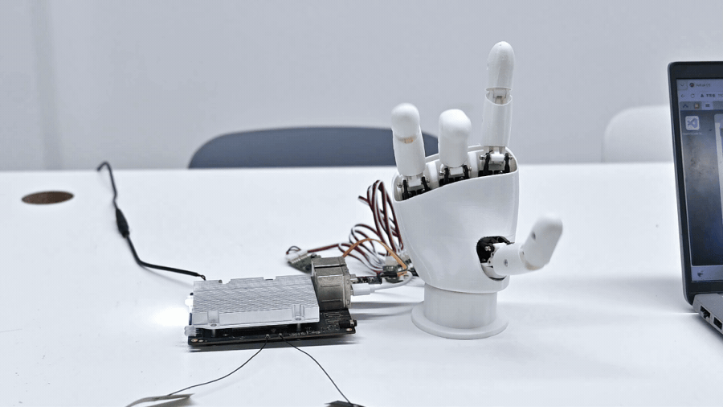

# AmazingHand_Rhinopi_A1

[](LICENSE)
[](DEPLOY_qcm6490_aidlux.md)
[](tools/requirements.txt)

**语言 / Languages**: 简体中文 | [English](README.en.md)

基于 **Qualcomm QCM6490（AidLux / Ubuntu 24.04）** 板卡驱动 [Pollen Robotics AmazingHand](https://github.com/pollen-robotics/AmazingHand) 灵巧手的**实机验证适配层**。

> 8 自由度开源灵巧手 · 8 × Feetech SCS0009 总线舵机 · Python + `rustypot`

仓库分两部分：

| 目录 | 内容 |
|---|---|
| `upstream/AmazingHand-main/` | 上游 Pollen Robotics 原始资料**完整快照**（CAD / STL / 固件 / 官方示例 / 装配文档 / MuJoCo 仿真） |
| `tools/` | 本仓库为 QCM6490 (AidLux) 板卡适配、并已在实机验证通过的可运行工具 |

> **English**: A field-verified port of the [AmazingHand](https://github.com/pollen-robotics/AmazingHand)
> dexterous hand to a Qualcomm QCM6490 board running AidLux / Ubuntu 24.04.
> The repo ships the full upstream snapshot under `upstream/` plus a hardened
> `tools/` layer: serial auto-detection, bus scanning, closed-loop verification,
> left/right hand selection and a dry-run mode.

---

## 机械手姿势展示



> 以上动图为 **QCM6490 (AidLux) 实机录制**：`python tools/hand_demo.py --loops 0`
> 连续跑完全部内置手势，全程走 1 Mbps 总线、8 个舵机闭环跟随。

`tools/hand_demo.py` 内置 12 个手势，全部由「中间位 + 偏移量」实时计算：

| 手势 | 效果 | 手势 | 效果 |
|---|---|---|---|
| `open_hand` | 五指完全张开 | `nonono` | 食指左右摇摆（摇手指） |
| `close_hand` | 快速握拳 | `perfect` | 拇指与食指相扣（OK / 点赞） |
| `open_hand_progressive` | 逐指渐进张开 | `victory` | 剪刀手 / V 字 |
| `spread_hand` | 手指向两侧铺开 | `scissors` | 剪刀手连续开合 |
| `clench_hand` | 用力攥握 | `pinched` | 拇指与指尖捏合 |
| `index_pointing` | 仅伸出食指 | `rock_sign` | 摇滚手势（食指 + 小指） |

复现方式：

```bash
python tools/hand_demo.py --side right   # 右手；左手用 --side left
python tools/hand_demo.py --loops 0       # 无限循环
```

> 手势方向依赖正确的中间位与 `--side` 设置，换手或未标定时手指会偏斜，
> 参见下文 [标定](#标定)。

---

## 这个仓库解决什么问题

上游 AmazingHand 提供了完整的 CAD、Arduino 示例和一份 Python demo，但那份 demo：

- 串口写死 `COM11`，换机器就跑不起来
- 不做舵机在线检查，接错线时直接抛 `Timeout error`，报错信息毫无指向性
- 左右手要手改源码里的 `Side = 1`
- 没有无硬件调试手段

本仓库是它在 **Qualcomm QCM6490 / AidLux** 上的适配版本，改动集中在可移植性与可调试性：

| 改动 | 说明 |
|---|---|
| 串口自动探测 | 不再写死端口。Linux 扫 `/dev/ttyUSB*`、`/dev/ttyACM*`、`/dev/ttyCH343USB*` 等；Windows 用 `pyserial` 枚举真实 COM 口 |
| 舵机在线扫描 | 启动时扫描 ID 1~8，逐个上报，缺失 ID 会明确列出 |
| 总线状态诊断 | `scan_bus.py` 一表列出每个舵机的位置 / 电压 / 温度 / 力矩使能 |
| 闭环验证 | `verify_closed_loop.py` 下发姿态后回读比对，实机误差 < 1.4° |
| 左右手切换 | `--side right \| left`，无需改源码 |
| DRY-RUN 模式 | `--dry-run` 不接硬件，只打印每帧目标角度，用于验证逻辑与调试手势 |
| 中间位可传入 | `--middle-pos` 直接传 8 个标定值，配合标定流程使用 |
| Windows 兼容 | 同一套代码在 Windows + CH340 转接板上亦可运行 |

---

## 硬件

| 部件 | 说明 |
|---|---|
| 主控 | Qualcomm QCM6490 (AidLux / Ubuntu 24.04.3 LTS) |
| 手 | AmazingHand，8 × Feetech **SCS0009** 总线舵机 |
| 转接板 | Feetech TTL 总线转接板（USB-Serial，CH340 / CP2102 等） |
| 总线参数 | **1 000 000 bps**，舵机 ID 1~8 |

舵机 ID 与手指的对应关系（每指 2 个舵机，`MiddlePos` 索引为 `id-1`）：

| 手指 | 舵机 ID | MiddlePos 索引 |
|---|---|---|
| index 食指 | 1, 2 | 0, 1 |
| middle 中指 | 3, 4 | 2, 3 |
| ring 无名指 | 5, 6 | 4, 5 |
| thumb 拇指 | 7, 8 | 6, 7 |

> 机械结构、打印件、装配图纸已包含在本仓库 `upstream/AmazingHand-main/cad/`，
> 原始出处：<https://github.com/pollen-robotics/AmazingHand>

---

## 快速开始

> 完整的**实机部署流程**（含软硬件环境实测数据、接线、systemd 开机自启、API 坑位）见
> **[DEPLOY_qcm6490_aidlux.md](DEPLOY_qcm6490_aidlux.md)**。下面是最短路径。

### 1. 克隆与安装依赖

```bash
git clone https://github.com/XIZAINB/AmazingHand_Rhinopi_A1.git
cd AmazingHand_Rhinopi_A1

python3 -m venv .venv
source .venv/bin/activate
pip install -r tools/requirements.txt
```

### 2. 串口权限

Ubuntu 下访问 `/dev/ttyUSB*` 需要串口权限，否则会报 `Permission denied`：

```bash
sudo usermod -aG dialout $USER
```

**重新登录**后生效。不想改权限也可以临时用 `sudo` 运行。

### 3. 确认转接板已识别

```bash
ls -l /dev/ttyUSB* /dev/ttyACM* 2>/dev/null
dmesg | tail -20          # 插拔转接板，看内核是否枚举成功
```

### 4. 扫描舵机

```bash
python tools/probe_servos.py          # 自动扫描所有串口
python tools/probe_servos.py /dev/ttyUSB0
```

正常输出：

```
== /dev/ttyUSB0 ==
  [发现] 舵机 ID: [1, 2, 3, 4, 5, 6, 7, 8]
    ID  1: 位置=+1.2579 rad  电压=51.0 V  温度=21 °C
    ...
✅ /dev/ttyUSB0  -> 舵机 [1, 2, 3, 4, 5, 6, 7, 8]
```

> 电压字段是舵机原始单位 **0.1 V**，`51.0` 表示 **5.1 V**。

### 5. 跑手势

```bash
python tools/hand_demo.py                 # 自动找串口，跑一遍全部手势
python tools/hand_demo.py --side left     # 左手
python tools/hand_demo.py --loops 0       # 无限循环，Ctrl+C 停止
python tools/hand_demo.py --dry-run       # 不接硬件，只打印目标角度
```

### 6. 闭环验证（可选）

```bash
python tools/verify_closed_loop.py /dev/ttyUSB0
```

下发姿态后回读实际位置，逐 ID 打印误差。实机测得 8 个舵机均 **< 1.4°**。

完整参数与 Windows 下的用法见 **[tools/README.md](tools/README.md)**。

---

## 目录结构

```
AmazingHand_Rhinopi_A1/
├── README.md                    本文件
├── README.en.md                英文版
├── DEPLOY_qcm6490_aidlux.md     QCM6490 / AidLux 实机部署指南（验证数据、接线、排障）
├── LICENSE                      Apache 2.0 全文
├── NOTICE                       上游归属声明（Apache 2.0 §4d 要求）
├── assets/gestures.gif          手势演示动图（QCM6490 实机录制）
│
├── upstream/AmazingHand-main/   上游 Pollen Robotics 原始快照
│   ├── PythonExample/           官方 Python 示例（串口写死 COM11）
│   ├── ArduinoExample/          官方 Arduino 方案 + 中间位标定程序
│   ├── Demo/                    进阶 demo（IK/FK、Rust 控制、MuJoCo 仿真）
│   ├── cad/                     STEP / STL 打印件
│   └── docs/                    装配文档与 PDF
│
└── tools/                       本仓库适配层（已在 QCM6490 实机验证）
    ├── README.md                参数手册与排障（中文）
    ├── README.en.md             参数手册与排障（英文）
    ├── scan_bus.py              总线扫描：位置/电压/温度/力矩
    ├── hand_demo.py             手势 Demo（衍生自上游 PythonExample）
    ├── verify_closed_loop.py    闭环验证：下发姿态并回读比对误差
    ├── probe_servos.py          多端口自动探测扫描（Linux + Windows）
    ├── requirements.txt         依赖清单
    └── watch_usb.sh             USB 热插拔监听（Linux）
```

> 本地工作区还会有一个 `vendor/` 目录，存放厂商提供的原始资料（飞特舵机驱动与上位机、
> Arduino IDE、SSCOM 串口工具、装配图纸、左右手打印件、`灵巧手装配体.STEP` 等）。
> 体积大且非本仓库所有，已在 `.gitignore` 中排除，不会随仓库分发。

---

## 标定

所有手势都是「中间位 + 偏移量」算出来的，**中间位不准，手势全歪**。
`hand_demo.py` 中的 `DEFAULT_MIDDLE_POS = [3, 0, -5, -8, -2, 5, -12, 0]` 是上游作者的标定值，**不能直接用于你的手**。

标定流程参见上游 `upstream/AmazingHand-main/ArduinoExample/Hand_FingerMiddlePos`。标好后用

```bash
python tools/hand_demo.py --middle-pos 3 0 -5 -8 -2 5 -12 0
```

逐组验证，确认满意再写入代码默认值。

---

## 故障排查

| 现象 | 原因 / 处理 |
|---|---|
| `Permission denied: '/dev/ttyUSB0'` | 未加入 `dialout` 组，见「串口权限」 |
| 扫不到任何舵机 | 90% 是串口选错（Windows 上尤其容易选到蓝牙虚拟串口）；其次检查转接板接线（信号 / 电源 / GND）与舵机供电 |
| `RuntimeError: Timeout error` | 端口上没有舵机应答。先跑 `probe_servos.py` 确认链路 |
| 转接板指示灯亮但仍扫不到 | 指示灯只代表转接板通电，不代表数据线通。确认接的是**总线口**而非 PWM 口 |
| 部分 ID 未响应 | 该舵机未接、ID 非 1~8，或总线接触不良 |
| 手势方向相反 / 撞限位 | `--side` 用反了，或中间位未标定 |
| 插拔后串口名变化 | `/dev/ttyUSB0` ↔ `/dev/ttyUSB1` 会变，建议用 `probe_servos.py` 自动扫描 |

---

## 许可协议

本仓库代码以 **Apache License 2.0** 发布，全文见 [LICENSE](LICENSE)。

选择 Apache 2.0 而非 MIT 的原因：本仓库的 `tools/hand_demo.py` 衍生自
[AmazingHand](https://github.com/pollen-robotics/AmazingHand) 的 `PythonExample/AmazingHand_Demo.py`，
而该上游项目以 Apache 2.0 发布。Apache 2.0 要求衍生作品保留原许可证并附带归属声明，
因此本仓库沿用同一协议，归属信息见 [NOTICE](NOTICE)。

上游机械设计（CAD / STL / 装配图纸）另以 **CC BY 4.0** 发布。
本仓库的 `upstream/AmazingHand-main/` 为其**原样再分发**，已保留全部原始许可文件；
如果你要再使用其中的机械设计文件，请遵守 CC BY 4.0 的署名要求。

---

## 致谢

- [Pollen Robotics](https://www.pollen-robotics.com/) — AmazingHand 原始设计与开源
- [rustypot](https://github.com/pollen-robotics/rustypot) — Feetech SCS 系列总线舵机协议实现

## 免责声明

本项目为第三方适配，非 Pollen Robotics 官方发布。舵机运动涉及机械结构，调试时请
先使用 `--dry-run` 验证角度范围，避免撞限位损坏打印件。使用风险自负。
